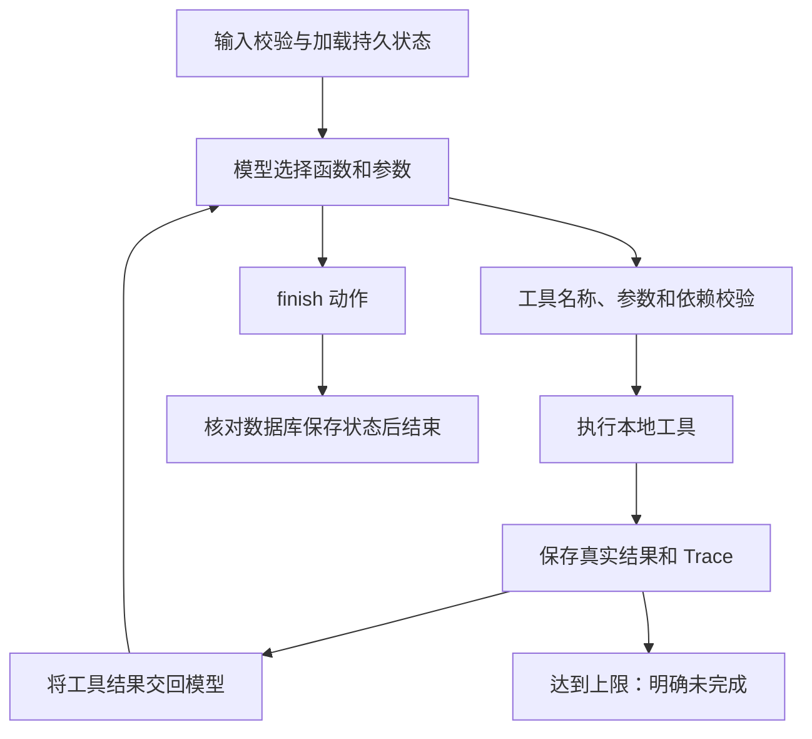

# 方案与工程取舍

## 技术选择

Python 3.10+ 标准库：argparse 做 CLI，urllib 调 DeepSeek，sqlite3 保存状态，decimal 做预算计算，unittest 测试。没有 Agent 框架，也没有运行时第三方依赖。可选 pytest 只是测试执行器，第一次检查使用 7.4.4。

最初设计考虑 Pydantic 和 pytest；最终参数结构仅涉及字符串、枚举、素材 ID 数组，采用显式校验与标准库测试，降低安装成本。JSON Schema 约束传给模型，本地再次校验，不能仅依赖模型遵守 Schema。

DeepSeek 接入：`POST /chat/completions`、`deepseek-flash`、`thinking.type=disabled`、原生 `tools`/`tool_calls`。每轮只接受一个工具动作，便于把观察与下一步清晰对应。多工具批次整体拒绝并反馈修正，不执行部分有副作用的动作。

参考官方文档：[接口与模型](https://api-docs.deepseek.com/quick_start/agent_integrations/)、[非思考模式工具调用](https://api-docs.deepseek.com/guides/tool_calls/)，核对日期 2026-10-28。协议测试模拟响应，没有替代真实服务验收。

## 调用与观察循环

执行器只负责通用循环与守卫，不预设“超预算后一定选择 basic”。真实模式的下一个动作来自模型 function call。离线 Mock 则是显式规则模拟器，按观察驱动分支，仅验证同一执行器的流程和约束。

`reason` 是模型提供的一句话行动依据，例如“估算超预算，改用基础剪辑后复核”；不要求或保存内部思维过程。Trace 含参数、返回摘要、完整结构化结果和下一动作，`mode` 区分真实与离线来源。

## 工具及状态

1. `search_materials(query)`：标签匹配检索，返回素材事实和费用目录，记录可用素材 ID。
2. `generate_script(material_ids, angle)`：只接受本任务已检索 ID，使用事实模板生成可编辑场景，记录来源。
3. `estimate_plan(script_id, production_mode)`：核算费用与串行耗时，列出替代制作方式估算；模型必须再选择方式并正式估算才能保存。
4. `save_plan(estimate_id)`：从已存在估算重新计算，只有当前约束满足才原子写入方案。
5. `finish(status, summary)`：模型观察保存或失败结果后的终止动作，completed 必须在数据库中有方案。

规划步骤状态 succeeded/failed 与方案内业务步骤状态 planned 分离。`output.json` 保留两类状态及成功产物；失败不会覆盖此前已成功脚本。

## 费用示例

P01 素材 2 + 脚本整理 1 + premium 制作 7 + 审核 1 + 发布 1 = 12。换 basic 制作 3，则总价 8。premium 总耗时 240 分钟，basic 为 120 分钟。价格来自文件，模型不能通过填写低价绕过工具。

## 持久化、幂等与续跑

SQLite 两张表：tasks 保存请求哈希、对话、成功缓存、步骤和状态；plans 按任务键唯一保存方案。任务键为 mode:request_id，隔离 Mock 和真实模型结果。

- BEGIN IMMEDIATE 原子获得执行锁；并发相同请求返回 request_busy。
- 执行锁租期 300 秒，每次检查点续期；HTTP 单次超时配置上限 120 秒。
- 方案以唯一键插入；保存成功但随后崩溃时，下次从数据库恢复，不重复生成。
- 缓存检索和脚本成功结果，失败结果不缓存。估算和保存重新核验时间。
- 素材/价格快照哈希变化时拒绝复用旧任务，要求新 request_id。
- `--resume` 读取完整工具对话，不从头开始；调用次数累计，不隐式重置。

业务工具只产生本地、可幂等副作用；未来如果对接真实付费工具，需要各工具自己的外部幂等键，SQLite 检查点不能替代分布式事务。

## 错误与安全边界

未知工具、非法参数、未知素材、缺少脚本、不可行方案等返回结构化工具错误，供模型继续决策。认证、网络、协议错误停止本次调用并保存状态，不假装模型成功。无效/纯文本模型输出也消耗模型轮数，防止无动作无限循环。

密钥只进入 HTTP Authorization；禁用重定向避免向其他地址转发凭据；不记录 HTTP 原始错误体、内部推理或密钥。系统提示将工具与素材定义为数据；预算、时区、依赖、保存状态由代码守卫。此演示未声称通过全面提示注入或生产级安全评测。

## 真实验收后的改进

素材增加 topic_terms，按用户原主题检查适用领域；即使模型把查询扩写为通用视频，也不能取得其他主题的素材并保存。该约束是工具边界，模型仍自行决定改写查询、请求补充或结束。脚本注入主题与受众但不编造个人经历，去重事实并合并引用；传播创意明确待审核。估算输出转换到截止时间的时区。历史输出和失败记录保留，见评估文档。

## 事实输出与显式恢复

angle 采用枚举限制开放能力断言；最终总结从实际工具状态构造，避免模型提案中的金额、状态或省略步骤建议直接成为业务结论。已失败任务显式续跑时增加用户恢复消息，包含历史状态与失败动作；由模型观察并选择动作，失败记录不改写，成功产物可复用，累计调用上限保持。详见 06-improvements.md。

## 独立验证层

audit.py 仅依据输入和原始资料/规则快照复算固定回放时钟下的预算和串行排期，不调用 BusinessTools.calculate。输入、估算及保存计划保持一致性，数据库实际记录作为保存依据。evaluate.py 支持独立重复试验，分开归档单次全量与重复结果，并保存源码哈希。
